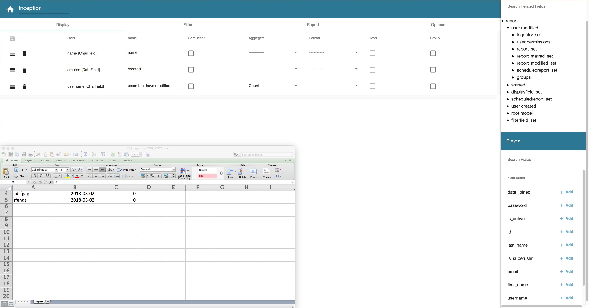

# django-report-builder

A GUI for Django ORM. Build custom queries and display results.
Targets sys admins and capable end users who might not be able to program or gain direct interactive shell access.

[](https://gitlab.com/burke-software/django-report-builder/commits/master)
[](https://gitlab.com/burke-software/django-report-builder/commits/master)

# Call for Sponsorship

<a href="https://liberapay.com/burke-software/donate"></a>

Are you a fan of Report Builder or using it at your workplace? Please consider sponsorship. You may donate on [Liberapay](https://liberapay.com/burke-software/donate) directly or contact me about sponsoring a feature. Right now, we need better documentation. Get your profile or company logo added to our Readme as a sponsor. Paid commercial support is also available. Email info@burkesoftware.com for more infomation.

# News

## 7.0.0

View more on the [CHANGELOG](CHANGELOG).

# What is Django Report Builder?



## Features

* Add filters
* Add display fields
* Preview and create xlsx reports
* Uses Django permissions models - Staff users must have "change" or "view" permission to view
  reports. Unprivileged users can still build reports and see database schema.
   * Report builder is intended for generally trusted staff users and requires is_staff to be set.
* Export to Report global admin action
* Scheduled reports can generate and send to users on cron like schedule
* Optional asynchronous report generation

# Documentation

http://django-report-builder.readthedocs.org/

[Google group](https://groups.google.com/forum/#!forum/django-report-builder/).

[Contributing](http://django-report-builder.readthedocs.org/en/latest/contributors/)

## Development quick start

This package uses Django in Docker and Angular CLI for development purposes.

1. Start docker `docker-compose up`
2. Migrate and  create an admin user `docker-compose run --rm web ./manage.py migrate`
3. Start the Angular CLI server. Ensure Node is installed. `cd js`, `yarn`, `yarn start`
4. Django runs on port 8000 by default. Go to localhost:8000/admin and log in.
5. Angular runs on port 4200. Now that you are logged in, go to localhost:4200

More detailed instructions are at [here](https://django-report-builder.readthedocs.io/en/latest/contributors/)

## NATOORA

#### Running BackEnd
To run local environment we can use UV package manager. 

```bash
# Install UV package manager
pip3 install uv 
```

```bash
# Since toml file already exists, we only need to sync and it will create virtual env automatically
uv sync --all-groups
```

```bash
# Activate Virtual Environment
source .venv/bin/activate
```

After activating the venv, we need to run `makemigrations` and `migrate`, which can also be done with UV.

```bash
uv run manage.py makemigrations
uv run manage.py migrate
```

##### Start Local Server
Runs automatically on `localhost:8000`
To access admin page go to `localhost:8000/admin`

!! Log In on the backend first to have access from the frontend.

```bash
uv run manage.py runserver
```

#### Running FrontEnd

To run the Angular we need to use node 14.21.3.
It's easier to use `nvm` to swap between node versions.

##### Mac Intallation - On new Macs - 
1- Install NVM to handle different Node versions
```bash
# Install NVM
brew install nvm
```

2 - Install roseta to run older versions
```bash
# It's necessary to use rosetta
softwareupdate --install-rosetta
```

3 - Make sure terminal is open with rosetta.
- Go to appliactions and find the terminal app
- Right-click -> Get Info, and select "Open with Rosetta"

4 - Now open the selected terminal and run old architecture, so Node 14 can be installed
```bash
# Run on terminal
arch -x86_64 zsh
```
5 - Install node version with NVM and use it.
```bash
nvm install 14.21.3
nvm use 14.21.3
```


#### Starting Angular
Angular runs on `localhost:4200`

Enter the folder `js` and run yarn to start it. 
```bash
cd js/
yarn
yarn start
```

